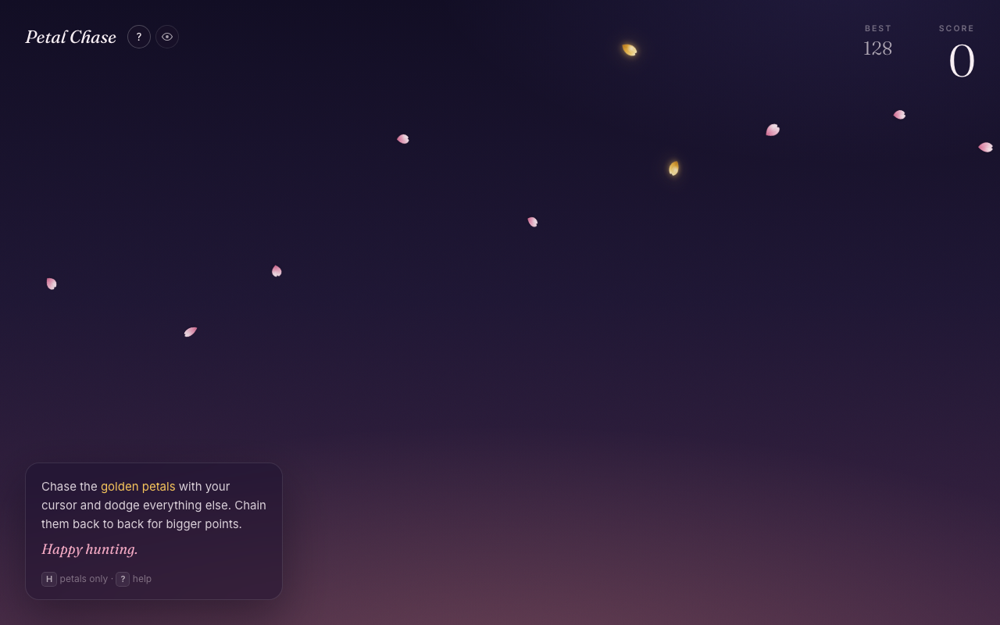

# Petal Chase

A small browser game built with TypeScript and React. Chase the **golden** petals with your cursor and dodge everything else. Chain golden petals back to back for bigger points and a faster, thicker fall. Touch a **pink** petal and the run is over.

**[Play it in your browser](https://boydwrites.github.io/petal-chase/)** (best with a mouse or trackpad)



## Playing

- Move your cursor through golden petals to score. Each new golden petal within 11 seconds of the last one extends your chain, and points climb 3, 6, 11, 18, 27…
- Touch a pink petal and the run is over. Your best score is saved in your browser.
- Press **H** to hide everything but the petals, and **?** to bring back the instructions.

## Run it locally

Requires Node.js 22.12 or later.

```sh
npm ci
npm run dev
```

Open the address Vite prints (usually `http://127.0.0.1:5173`). `npm run build` writes a static site to `dist/`, and `npm run preview` serves that build locally. No accounts, backend, or API keys are needed.

The game needs a mouse or trackpad and a window at least 821 px wide. On touch screens and narrow windows the petals fall as decoration, without scoring. With reduced motion turned on, there are no petals and the page explains why. All of this updates live if your setup changes.

## How it's built

- **Motion never jumps.** Petals are DOM elements animated with CSS. Each petal's fall timing is fixed when it appears, so a speed change starts a fresh petal instead of yanking one mid-fall. A touched petal flutters away on a damped spring and drifts back.
- **Fast sweeps still count.** Each petal has an elliptical hitbox that follows its shape. Golden petals are tested against the cursor's full path, including the stretch it crosses between frames, so a quick sweep scores. Pink petals are tested only where the cursor is each frame, so a near miss stays a near miss.
- **Scoring and difficulty are separate.** Every fresh pass through a golden petal scores, but only the first touch of each petal extends the chain. A chain lasts 11 seconds between golden touches, and points climb 3, 6, 11, 18, 27… Fall speed, density, and spawn rate all rise with the chain, up to fixed limits.
- **The game adapts to the device.** One shared hook decides what each device can run. Touch screens get decoration, reduced motion gets a still page, and neither runs the scoring loop.

Start with the rules and tuning in [engine.ts](src/game/engine.ts), then the rendering and game loop in [PetalField.tsx](src/game/PetalField.tsx), and the device rules in [useDeviceMode.ts](src/game/useDeviceMode.ts).

## Tests

```sh
npm test
npm run typecheck
npm run build
```

The tests cover hit detection along the cursor's path, repeated passes, chain scoring, difficulty limits, the spring response, and animation timing. How the motion looks, and the touch and reduced-motion fallbacks, are checked by hand in a browser.

CI runs the tests, type check, and build on every push and pull request. The playable demo deploys to GitHub Pages from a manually run workflow.
